<p align="center"></p>

<p align="center">
  
  
  
  
  
  
</p>

<p align="center">
  
</p>

## What it is

**SmartSchool Manager** is a web app that runs the day-to-day admin of a school: students, daily attendance, fee collection with receipts, exam marks, report cards and notices to parents. Each school gets its own isolated workspace in Supabase. The **admin** registers the school and shares a school code, and **teachers** join with that code to mark attendance and enter marks.

<p align="center"></p>

## Features

| | Feature | Details |
|---|---|---|
| 🏫 | **Multi-school sign-up** | Admin creates a school and gets an 8-character school code; teachers join with it. Every row is scoped to its school by Row Level Security. |
| 👩‍🎓 | **Students** | Add / edit with photo (private storage, signed URLs), search by name or roll, filter by class and fee status, paginated list. |
| 📥 | **Bulk upload** | Excel/CSV import with a downloadable template, preview before saving, Excel / `YYYY-MM-DD` / `DD/MM/YYYY` dates, per-row error reasons. |
| ✅ | **Attendance** | Per class and date: present / absent / late, "all present" shortcut; 30-day heatmap on each student's page. |
| 💰 | **Fees** | Annual fee per student, collect cash / UPI / bank / cheque payments, receipt with QR code and PDF download, Paid / Partial / Unpaid views per academic year. |
| 📝 | **Marks** | Per class, subject and exam (unit test / mid term / final), automatic grades, re-open to review and edit saved marks. |
| 📄 | **Report cards** | Per exam and student, on-screen preview, PDF download, or a ZIP of the whole class. |
| 📣 | **Parent alerts** | Message templates, send by email via EmailJS (optional) or log only, alert history. |
| 📊 | **Dashboards** | Admin: students, fee defaulters, today's attendance, exams, 6-month fee collection chart. Teacher: today's attendance per class and assigned subjects. |
| 🔐 | **Role-based access** | Admin-only routes for fees, reports, alerts and student management; teachers see attendance, marks and students. |

## Screenshots

<sub>All screenshots use fictional demo data.</sub>

| Admin dashboard | Students |
|---|---|
| 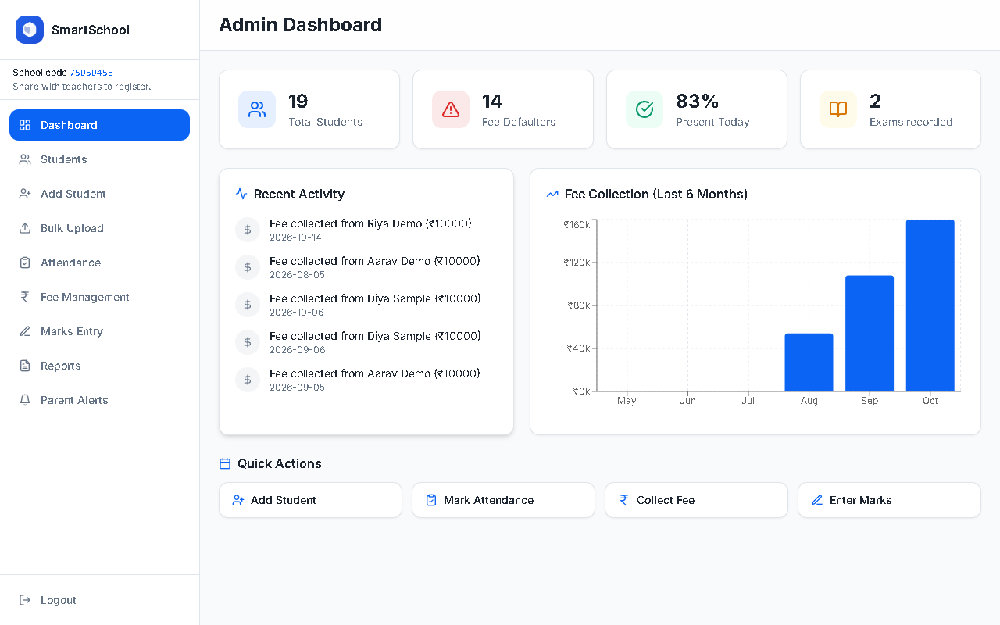 | 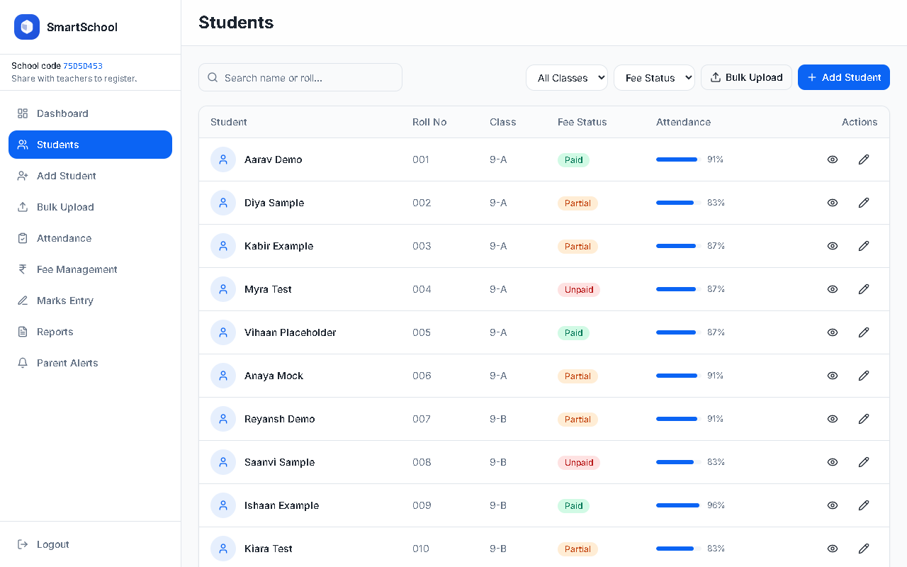 |
| **Fee management** | **Attendance** |
| 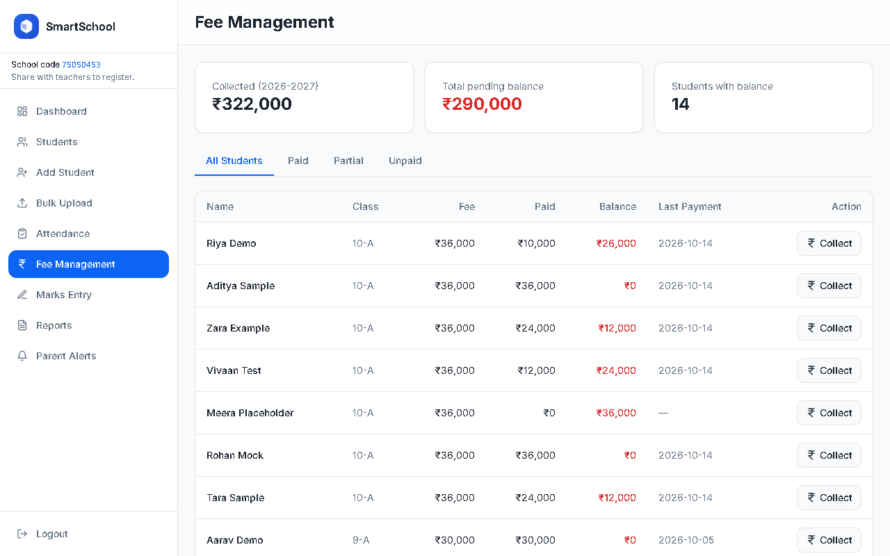 | 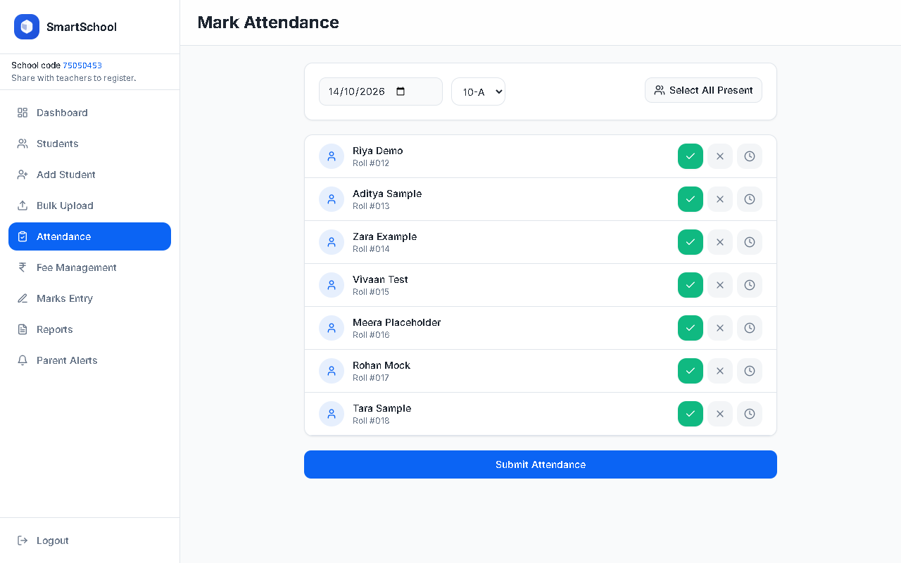 |
| **Marks entry** | **Report card preview** |
| 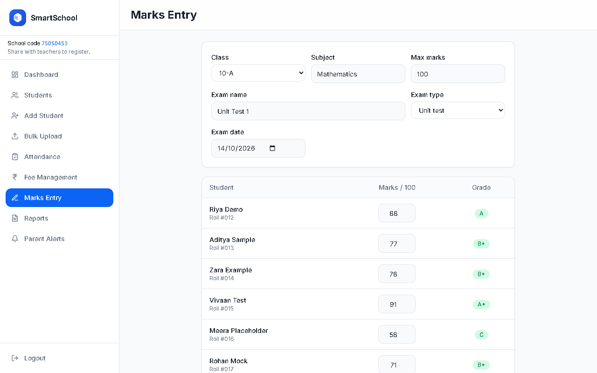 | 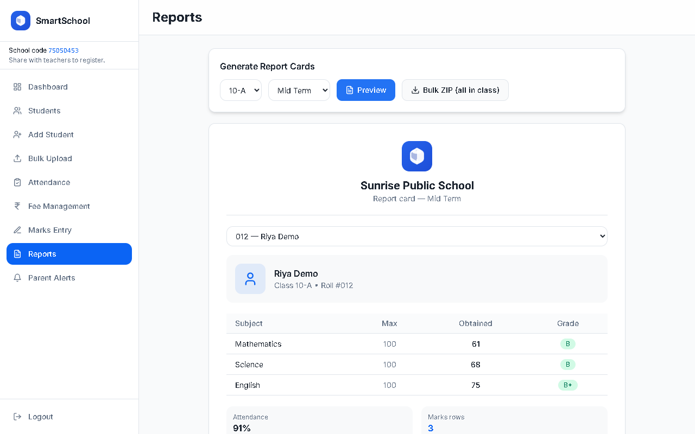 |
| **Student profile** | **Teacher dashboard** |
| 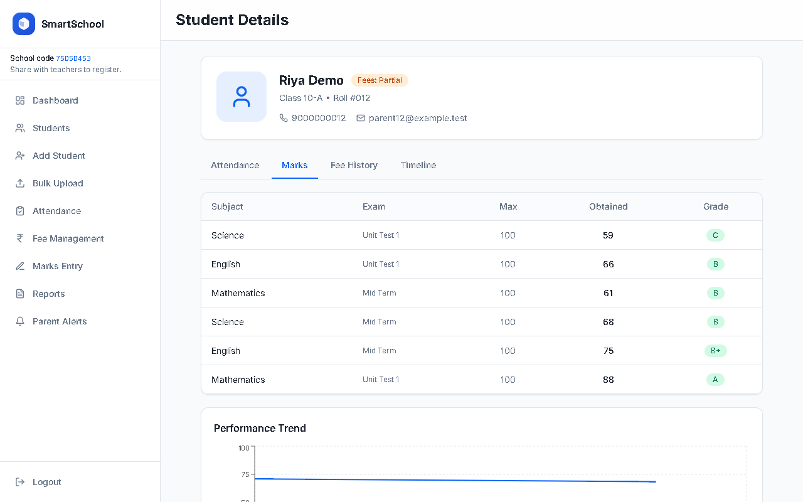 | 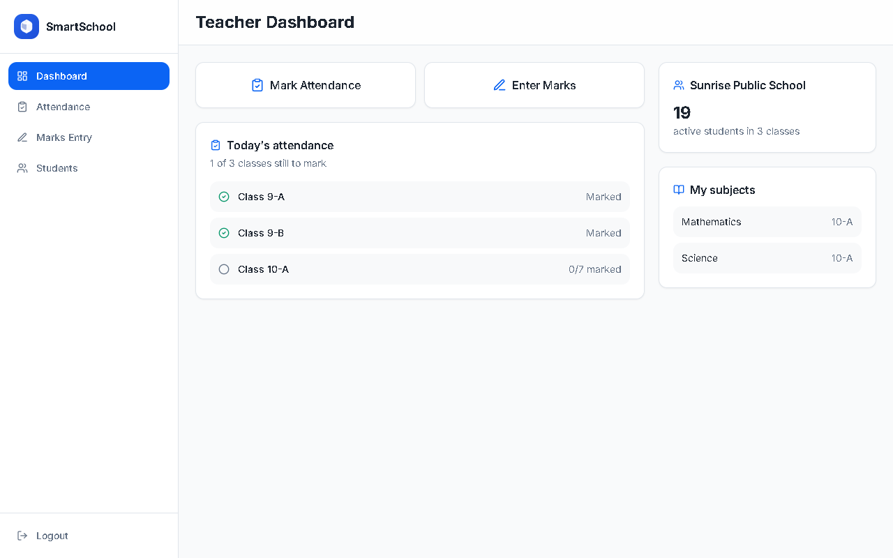 |

<details>
<summary>Landing page and mobile view</summary>

<p align="center">
  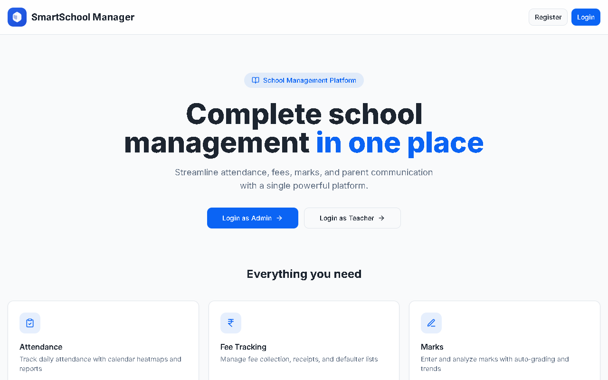
  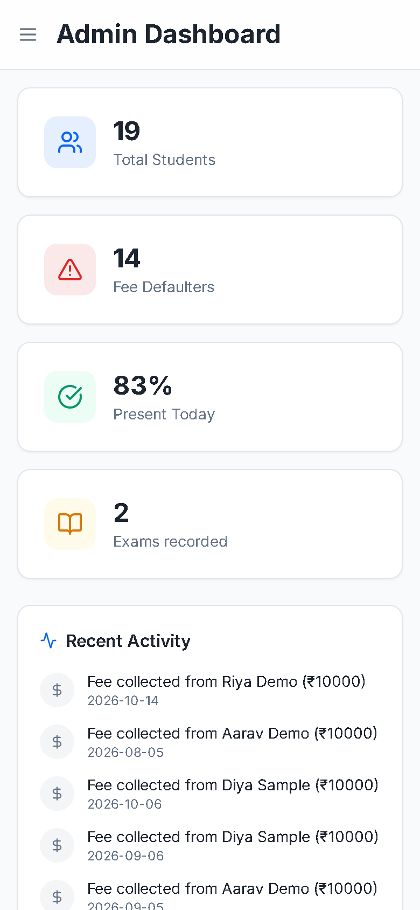
</p>
</details>

## How it works

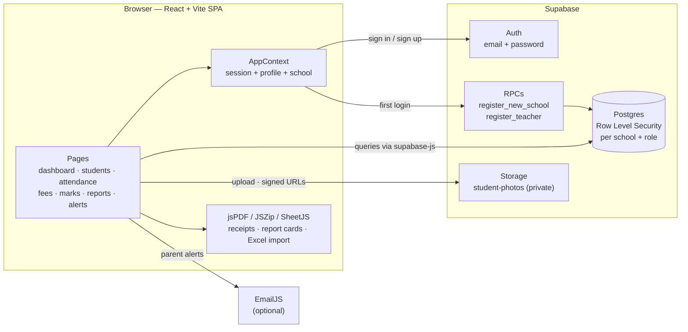

Access rules live in the database, not just the UI: `get_my_school_id()` and `get_my_role()` drive the RLS policies, so a teacher can read students and write attendance/marks for their own school only, while fees, alerts and student edits are admin-only.

## Quickstart

**Prerequisites:** Node 18+ and a free [Supabase](https://supabase.com) project.

```bash
git clone https://github.com/ekupekuAI/bloomwise-school.git
cd bloomwise-school
npm install
cp .env.example .env    # then fill in the values below
npm run dev             # http://localhost:8080
```

Database setup (Supabase → SQL editor, run in order):

1. `supabase/migrations/001_initial_schema.sql` — tables, helper functions, RLS
2. Create a storage bucket named `student-photos`, then run `002_storage_student_photos.sql`
3. `supabase/migrations/003_security_hardening.sql` — **required**, also on existing projects (private photos, locked-down roles, tenant checks)

Open `/register`, choose **New school (Admin)**, then share the school code shown in the sidebar with your teachers. If your project requires email confirmation (Supabase's default), the school or teacher profile is created on the first sign-in after confirming.

### Environment variables

| Name | Required? | Where to get it |
|------|-----------|-----------------|
| `VITE_SUPABASE_URL` | ✅ Yes | Supabase dashboard → Project Settings → API → *Project URL* |
| `VITE_SUPABASE_ANON_KEY` | ✅ Yes | Same page → *anon / public* key |
| `VITE_EMAILJS_SERVICE_ID` | Only for email alerts | [EmailJS](https://dashboard.emailjs.com) → Email Services |
| `VITE_EMAILJS_TEMPLATE_ID` | Only for email alerts | EmailJS → Email Templates (template variables: `to_email`, `message`, `school`, `type`) |
| `VITE_EMAILJS_PUBLIC_KEY` | Only for email alerts | EmailJS → Account → *Public Key* |

Without the Supabase variables the sign-in pages show a setup notice instead of crashing. Without EmailJS, alerts can still be recorded with **Log only**.

### Scripts

| Command | What it does |
|---------|--------------|
| `npm run dev` | Dev server on port 8080 |
| `npm run build` | Production build into `dist/` |
| `npm run preview` | Serve the production build |
| `npm run lint` | ESLint |
| `npm run test` | Unit tests (Vitest) |
| `npm run test:e2e` | Playwright tests; dashboard tests need `E2E_ADMIN_EMAIL` / `E2E_ADMIN_PASSWORD` (and `E2E_TEACHER_*` for teacher tests) |

Deploying: any static host works. `vercel.json` and `public/_redirects` (Netlify) already rewrite all routes to `index.html`.

<details>
<summary><b>Project structure</b></summary>

```text
bloomwise-school/
├── public/                    # logo, favicon, SPA redirects
├── src/
│   ├── App.tsx                # routes + role guards
│   ├── context/AppContext.tsx # auth session, profile, school
│   ├── components/
│   │   ├── DashboardLayout.tsx, AppSidebar.tsx, ProtectedRoute.tsx
│   │   ├── StudentPhoto.tsx   # signed-URL photos from the private bucket
│   │   ├── SetupNotice.tsx    # shown when .env is missing
│   │   └── ui/                # shadcn/ui primitives
│   ├── lib/
│   │   ├── supabase.ts        # client + isSupabaseConfigured
│   │   ├── registration.ts    # school / teacher profile creation
│   │   ├── academicYear.ts, dates.ts, fees.ts, grades.ts, classes.ts
│   │   ├── bulkUpload.ts, receipt.ts, search.ts, photos.ts
│   ├── pages/                 # Landing, Login, Register, Admin/Teacher dashboards,
│   │                          # StudentList, AddStudent, StudentDetail, BulkUpload,
│   │                          # MarkAttendance, FeeManagement, MarksEntry, Reports, ParentAlerts
│   └── test/                  # Vitest unit tests
├── supabase/migrations/       # 001 schema · 002 storage · 003 security hardening
├── e2e/                       # Playwright walkthrough
└── docs/readme/               # banner + screenshots used in this README
```
</details>

## What's new in this version

| Area | Before | After |
|------|--------|-------|
| 🔐 Roles | A teacher could update their own row to `role = 'admin'` or move to another school's `school_id` | Only `full_name` is editable, enforced by column grants **and** a trigger |
| 🖼️ Student photos | Public bucket; anyone, even signed out, could list and download every school's photos | Private bucket, readable only by the same school, short-lived signed URLs (old URLs still work) |
| 🧱 Tenant checks | Attendance / fees / marks could point at another school's student | Database trigger rejects cross-school references; `marked_by` / `created_by` / `sent_by` set server-side |
| ⚙️ Setup | Missing `.env` → blank white page | Clear setup notice; `.env.example` holds placeholders only |
| ✉️ Sign-up | With email confirmation on, accounts never got a profile and couldn't log in | Profile is completed on first sign-in |
| 💰 Fees | Previous years' payments counted toward this year; pages disagreed on status; double-clicks recorded duplicate payments; colliding receipt numbers; garbled ₹ in PDF | Year-scoped totals, one shared Paid / Partial / Unpaid / No-fee-set status, duplicate-safe collect, unique receipts, readable PDF |
| 📅 Dates | UTC dates, so entries before 5:30 am IST landed on the previous day | Local dates everywhere |
| 📝 Marks | Blanks saved as 0, no max check, saved marks not shown | Blanks skipped, 0–max validation, saved marks load for editing |
| 📄 Report cards | All exams summed into one total, preview of first student only | Choose exam and student |
| 📊 Dashboards | Fake "pending" bars, "0% present" when not marked, teacher dashboard was hard-coded sample data | Real data only; "Attendance not marked today"; teacher sees live class status and subjects |
| 📣 Alerts | Logged as "sent" even when email wasn't configured or failed | Blocked with a clear message, or logged honestly (`logged` / `sent` / `partial` / `failed`) |
| 📥 Bulk upload | Excel dates failed, `DD/MM` read as `MM/DD`, missing gender became "Male" | Dates normalized, gender left blank when unknown, failures list the reason |

Smaller fixes: student search no longer breaks on commas or brackets, class names containing `-` work in every filter, the photo picker shows a preview, an unknown student ID shows "not found" instead of loading forever, and lint is clean.

## Future development

- Set annual fees for many students at once (today: per student, via **Students → Edit**).
- Let admins view and remove teachers who joined with the school code.
- SMS / WhatsApp delivery for parent alerts (currently email via EmailJS or log only).
- A light / dark theme toggle (dark theme tokens already exist in `src/index.css`).

## License

Private / your terms — configure as needed for your repository.
